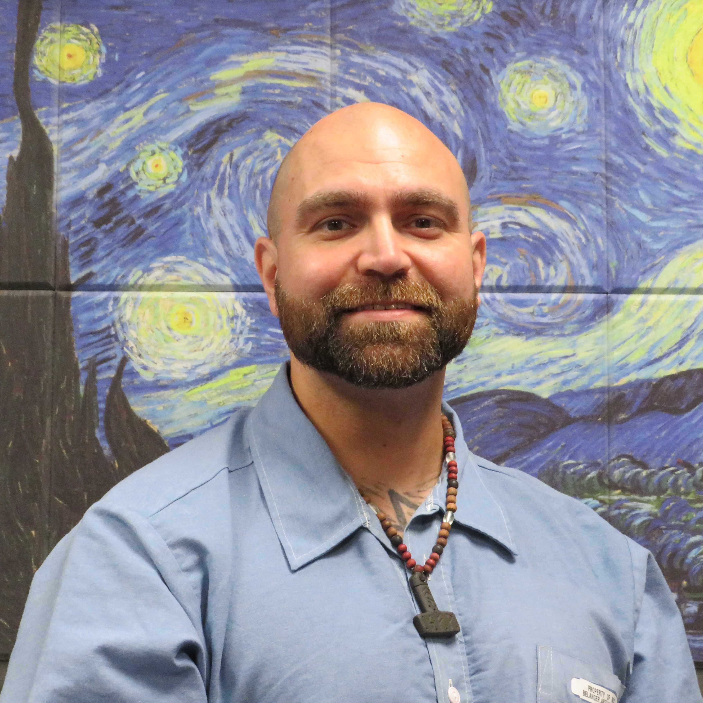

# 
👋 Hi, I'm Arty (RunicAudio)

  

## 🎛️ Lead Web Developer (Bread of Life) | MIT Brave Behind Bars TA | Music Tech & CIS Student | Audio Software Dev

Hi, I'm **Arty**.

Prior to 2023, at forty years old, I had never turned on a laptop[cite: 1]. Today, less than three years later, I am building full-scale web applications and software across multiple programming languages, studying **Computer Information Systems** and **Music Technology** at the University of Maine at Augusta, and using technology as a vehicle for community empowerment and educational equity.

My journey is proof that it is never too late to learn, adapt, and build a meaningful career. Today, my work lives at the intersection of **software engineering, community impact, and audio technology**, from leading web development for local organizations to teaching computer literacy, coding and prototyping digital signal processing tools.

---

## ⚡ The Journey: 0 to Full-Stack in Under 3 Years

- **Before 2023:** Zero computer experience; had never touched or turned on a laptop.
- **Today:**
  - **Teaching Assistant** for [MIT's Brave Behind Bars](https://bravebehindbars.org/), teaching web development, coding, and technical skills to incarcerated students.
  - **Lead Web Developer** for [Maine Bread of Life](https://mainebreadoflife.org/) in Augusta, Maine, building web solutions to support local food security and community outreach for Veteran's across Maine.
  - **Developer** for local community organizations, including the [Augusta Downtown Alliance](https://augustadowntown.com/).
  - **Software Creator** building multi-language applications across web, education, and audio software engineering.

---

## 🚀 Key Projects & Roles

### 🏛️ Community & Educational Leadership
* **[MIT Brave Behind Bars](https://bravebehindbars.org/) (Teaching Assistant):** Mentoring adult learners in practical web development, digital skills, and programming fundamentals to assist with re-entry and life transformation.
* **[Maine Bread of Life](https://mainebreadoflife.org/) (Lead Web Developer):** Building and maintaining the primary platform for local food security outreach in Augusta, ME ([BOL Repository](https://github.com/RunicAudio/maineBreadOfLife)).
* **[Augusta Downtown Alliance](https://augustadowntown.com/) (Web Development):** Supporting downtown revitalization and digital presence for local businesses and community development ([ADA Repository](https://github.com/RunicAudio/augusta_downtown_alliance.git)).

### 🎛️ Audio Engineering & Educational Apps in Development
* **Educational Tools:** Creating interactive software and curricula designed to help non-traditional learners and adult students build real-world coding skills.
* **Audio Engineering & DSP:** Prototyping custom audio plugins, virtual instruments, and digital signal processing (DSP) algorithms in C++ to assist musicians and creators.

---

## 🛠 Tech Stack & Tools

### Software Engineering & Web
- **Languages:** Python, C++, JavaScript, HTML5, CSS3, SQL, Bash
- **Frameworks & Libraries:** Flask, Django, Streamlit, Flet, Node.js, Bootstrap, Jinja, Vite
- **Tools & Workflow:** Git & GitHub, Linux, Visual Studio Code

### Audio & Music Technology
- **Tech & Frameworks:** C++, JUCE, Max/MSP, Digital Signal Processing (DSP), Aubio, SoundDevice
- **Production:** Recording, Mixing, Audio Production, DAWs, MIDI, Music Theory

---

## 🎸 Core Values

- **Growth Through Building:** Mistakes and iterations are the fastest path to mastery.
- **Lifting Others Up:** Knowledge is most impactful when shared to create new opportunities for others.
- **Code Meets Creativity:** Software should bridge technical precision with artistic expression.

---

### 
🎵 Where Code Meets Creativity, and Music Becomes Possibility.

---

  

